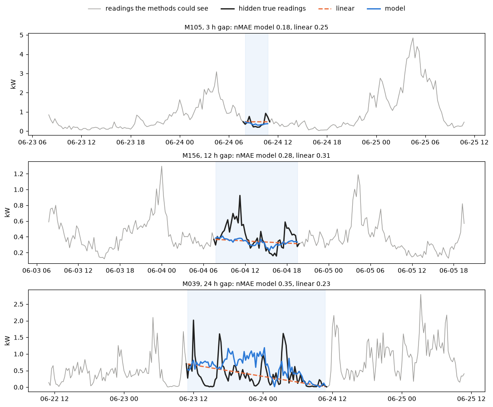

# smart_meter_data_imputation

Filling gaps in smart-meter load profiles.

I work at a Thai electricity authority. Our smart meters record the energy each
customer uses in every 15-minute interval. This series of readings is the
customer's load profile, and it shows how their electricity use changes through
the day and the week. When a meter or its communication link fails, the load
profile comes back with gaps in it, and when a customer asks for their load
profile, the gaps are filled with linear interpolation. Bills are not affected,
because they are based on the meter's cumulative energy readings at the start
and end of each month. Over a gap of several hours, linear interpolation misses the rise
and fall of the customer's daily use.

This project trains a machine-learning model that improves on the linear
interpolation we already use, filling gaps of up to 24 hours closer to the real
readings. Longer gaps are left empty and flagged for review, because a gap of
more than a day may mean the meter has a fault and needs an on-site check.

I built the model for the authority and trained and tested it on its real meter
data, about 20,000 meters. That data belongs to our customers and can't be
published, so this repository runs on a synthetic dataset instead. The results
on the real meters are close to the ones below.

## Project Structure

| File | Description |
| --- | --- |
| [`smart_meter_data_imputation.ipynb`](smart_meter_data_imputation.ipynb) | Data preparation, feature engineering, training, evaluation and filling real gaps. |
| `synthetic_load_profile.csv` | 200 synthetic meters, January to June 2026, 15-minute readings in kW. The synthetic dataset was generated to match the real data's statistics. |

## The synthetic dataset

I measured statistics across all the real meters and drew 200 new meters from
them: how large meters are, how much their load moves from one reading to the
next, their daily and weekly patterns, seasonal and holiday changes, zero
readings, and how long and how often gaps occur. Every synthetic meter gets its
own randomly drawn parameters and its own random noise, so none of them follows
a real customer, and no real meter's readings are in the file.

## How the model is evaluated

The first version of this project split each series by time, trained on the
first 85% and tested on the rest, with the previous reading as a feature. Every
prediction could see the true reading from 15 minutes earlier, so it measured
one-step forecasting. In a real gap that reading is missing, so the error it
reported was much lower than what the model would achieve in use.

Now I hide readings that do exist, in blocks of 15 minutes to 24 hours, let each
method fill them, and compare the fills with what was hidden. The training rows
are built the same way, so the model learns from the situation it will meet in
use, and its features are built from the series with the gap already in it.

The first 80% of the timeline trains the model and the last 20% tests it, and the
gaps are simulated separately in each period. The main metric is nMAE, the mean
absolute error divided by the meter's mean load, so meters of different sizes
can be compared. I report the median across meters, split by gap length.

## The model

The model is scikit-learn's `HistGradientBoostingRegressor`. Linear
interpolation is already in use, so the model starts from it: for each missing
reading it predicts the residual, which is how far the real reading is from the
linear interpolation, and adds that correction back. With nothing to correct, it
returns the linear interpolation.

It learns the correction from 13 features:

- `reading_previous` and `reading_next`: the last reading before the gap and
  the first reading after it
- `reading_linear_interpolation`: the linear interpolation value at this position
- `intervals_since_previous` and `intervals_until_next`: the number of 15-minute
  intervals since the last reading and until the next one
- `gap_len`: the length of the gap
- `reading_previous_day`, `reading_next_day` and `reading_previous_week`: the
  readings at the same time one day earlier, one day later and one week earlier
- `weekday_time_average_load`: the meter's average load for this weekday and
  time of day, from the training period
- `tod_sin` and `tod_cos`: the time of day
- `is_holiday`: whether the day is a Thai public holiday

It is trained with absolute error.

## Results

Median per-meter nMAE on the simulated gaps in the test period:

| Gap length | 15 min | 1 h | 3 h | 5 h | 8 h | 12 h | 16 h | 24 h |
| --- | ---: | ---: | ---: | ---: | ---: | ---: | ---: | ---: |
| Model | **0.154** | **0.203** | **0.280** | **0.290** | **0.309** | **0.324** | **0.327** | **0.408** |
| Linear interpolation | 0.157 | 0.217 | 0.305 | 0.355 | 0.458 | 0.484 | 0.541 | 0.610 |

Over all gaps the model scores 0.345 against linear interpolation's 0.426. It
is the better method on 89% of the meters, and its MAE is 32% lower, 0.356 kW
against 0.527 kW. At 15 minutes the two are level. On longer gaps linear interpolation
cuts through a day that has a shape, and the model, which knows the meter's
daily pattern, pulls ahead.

Below are three gaps from the test period whose true readings were hidden. Each
method filled them, and the hidden readings are drawn back in.

## Limitations and next steps

- The test period covers one season, about five weeks from late May to June.
  Load in Thailand follows temperature and holidays, so the results need
  re-checking over a full year.
- There is no weather data. Temperature is the obvious next feature.

## Tools & Libraries

The notebook was run with Python 3.14 in Jupyter Notebook.

| Library | Version | Used for |
| --- | --- | --- |
| pandas | 2.0 or later | loading and reshaping the meter data |
| NumPy | 1.24 or later | building the features and simulating gaps |
| scikit-learn | 1.3 or later | `HistGradientBoostingRegressor` for the model, and the linear regression in the ablation |
| matplotlib | 3.7 or later | the charts |
| joblib | 1.3 or later | saving the trained model |

## License

MIT, see [LICENSE](LICENSE).
